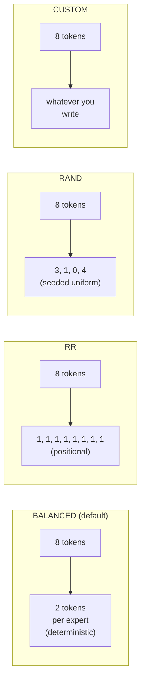

# MoE expert routing

For Mixture-of-Experts models, every token visiting an MoE layer
needs an answer to two questions: **which experts do I activate** and
**which EP rank holds them**. The first is the model's gate
function; the second is determined by how the simulator assigns
experts to ranks. This page is about both.

> Configuration angle (`--expert-routing-policy` flag, when to use
> which) is on **[Examples → Expert parallel](/docs/examples/parallelism/expert-parallel)**.
> This page is the internal mechanics.

## The piece that does it: `GateRouter`

`serving/core/gate_function.py` defines `GateRouter`. The trace
generator instantiates one per simulation; on every MoE block it
calls:

```python
GateRouter(
    num_local_experts=N,           # total experts in the model
    num_experts_per_token=K,       # top-K activations per token
    routing_policy='BALANCED',     # one of 4 policies, see below
    seed=42,
    block_copy=True,
)

result = router.route(num_tokens=T, tp_rank=r, num_experts_per_token=K)
# → RoutingResult(local_tokens=[...], activated_experts=[...], source_tokens=[...])
```

`local_tokens[i]` is the number of tokens assigned to EP rank `i`
after dispatch. `activated_experts[i]` is the count of distinct
experts touched on that rank. Both feed into the per-rank attention/MLP
latency lookup.

## Four policies



| Policy | Determinism | What it models | When to use |
| --- | --- | --- | --- |
| **BALANCED** (default) | Deterministic | Idealized load-balanced gate (post-aux-loss training) | Most research baselines |
| **RR** | Deterministic | Pure round-robin assignment | Sanity / null-baseline runs |
| **RAND** | Seeded random | Uniform random per token | Worst-case load imbalance studies |
| **TRACE** | Deterministic | Recorded decisions of a real router | Skewed, drifting, per-layer routing; placement studies |
| **CUSTOM** | Plug-in | Whatever you write | Real trained gate weights, ablation |

### BALANCED, closed-form pigeonhole

BALANCED computes the *exact* token distribution that a perfectly
load-balanced gate would produce: for `T` tokens and `E` experts with
top-`K`, each expert gets `T*K/E` tokens (with the remainder split
deterministically across experts to round to integers).

This is what a model with a well-trained auxiliary load-balancing
loss converges to in expectation. It's the simulator's default
because:

1. Real production MoE deployments use auxiliary losses → balanced
   distribution is the realistic baseline.
2. It's deterministic, so simulations are reproducible.
3. It enables the **block copy** optimization (see below).

### RR, round-robin

Token *t* goes to experts `t, t+1, ..., t+K-1` (mod `num_local_experts`).
Same experts each forward, regardless of token content. Useful as a sanity check or
when you want a "no smart routing" baseline; produces identical
per-rank token counts to BALANCED in expectation.

### RAND, random

Per-token uniform random across experts (using `seed=42` by default
for reproducibility). Produces realistic worst-case load imbalance
- some ranks see more tokens than others, which is what an
*untrained* gate produces. Use this if you want to study the cost of
load imbalance specifically.

### TRACE, replayed real routing

Replays a routing trace (`--expert-routing-trace`, an `.npz`) that
records which top-K experts every token position of every request
picked in every layer. Each iteration looks up exactly the positions
the scheduler ran: for each request in the batch, positions
`[computed_before, computed_before + scheduled)`. DP padding tokens,
which belong to no request, are spread round-robin. Routing differs per
layer, so TRACE always disables block copy.

The trace's request ids must match the workload's: request `i` is the
`i`-th flat line of `--dataset`, and an agentic session takes one id per
sub-request. A request or position missing from the trace is an error,
not a fallback. Build one with:

```bash
# real router decisions; the workload must come from the sharegpt
# generator run with the same --model (needs torch + transformers)
python -m workloads.generators routing-capture --model <hf-id> \
    --dataset workloads/<workload>.jsonl --output workloads/<workload>.routing.npz

# synthetic Zipf skew, no GPU: --skew (0 = uniform), --phase-reqs (drift),
# --stickiness (token-to-token reuse)
python -m workloads.generators routing-synthetic --model <org>/<name> --skew 1.0 \
    --dataset workloads/<workload>.jsonl --output workloads/<workload>.zipf1.npz
```

Capture runs one teacher-forced forward pass over
`input_tok_ids + output_tok_ids`. Models whose router-logit count differs
from `num_hidden_layers` (DeepSeek's leading dense layers) are rejected.

### CUSTOM, plug-in

Edit `gate_function.py::GateRouter._custom_routing`. The hook
receives the token list and returns expert assignments per token.
Use this if you want to drive routing from real trained gate weights
or a learned-from-trace model.

## Expert-to-rank assignment

Whatever policy decides "token T goes to expert E", the simulator
also has to know "expert E lives on which rank". That is a per-layer
map held by `ExpertPlacement` (`serving/core/expert_placement.py`),
chosen by `--expert-placement-policy`:

| Policy | What it does |
| --- | --- |
| **EVEN** (default) | `min(e * ep_size // num_experts, ep_size - 1)`, never changes |
| **POPULARITY** | Hottest expert first onto the least-loaded rank with room, using an EMA of observed per-expert tokens; kept only if it lowers the hottest rank's load. Rebuilds the whole map, so up to every expert can move at once |
| **SWAP** | Incremental: up to `--expert-placement-max-swaps` swaps per layer between the hottest and coldest rank, each the pair that best evens them out. A swap moves two experts |
| **CUSTOM** | Edit `ExpertPlacement._custom_placement` |

With EVEN, 128 experts and `ep_size=2` put experts 0–63 on rank 0 and
64–127 on rank 1.

`--expert-placement-interval N` re-places only every N iterations, while
load is still tracked every iteration. Use it, or SWAP, for a baseline a
real system could afford: rebuilding the map every step moves so many
weights that the transfers swamp any balancing gain.
`--no-charge-expert-migration` makes moves free, which bounds what any
placement can gain on a given trace.

The placement object persists across iterations (one per instance,
shared by a DP group, since EP spans the group). Before each batch's
trace is built, `begin_iteration()` folds in the per-expert counts that
earlier iterations routed and lets the policy re-place. A policy never
sees the routing of the iteration it places for.

Constraints and simplifications:

- Every rank must hold exactly `num_experts // ep_size` experts, because
  expert weight memory is sized as an even share per rank.
- Moving an expert costs a weight load. Each expert that changes owner
  is owed to its new rank, and in that layer's next MoE block the rank's
  `expert` row carries `REMOTE` weights of `moved experts × 3 × hidden ×
  moe_intermediate × dtype bytes`. The converter turns that into a load
  that starts after the gate and gates the rank's expert compute, charged
  at `cpu_mem.mem_bw`: set that to your host-to-GPU rate (PCIe), not DRAM
  bandwidth. There is no prefetch and no overlap with earlier layers, and
  the memory the copy holds in flight is not modelled. Experts whose
  weights are already offloaded are loaded every step and owe nothing.
- Deciding costs time. An iteration whose placement was recomputed gets an
  `expert_placement` compute row right after the embedding, as long as the
  policy took (`--expert-placement-overhead measured`) or a fixed number of
  ns. EVEN never recomputes. Not supported with sub-batch interleaving.
- Any placement other than EVEN disables block copy, since each layer is
  placed, and owes migrations, on its own.
- BALANCED routing is uniform, so with it every placement gives the
  same result. Placement only matters with RR, RAND, TRACE or CUSTOM.

### Expert memory pressure and precision

By default every expert is resident. `--expert-memory-fraction F` lets
each EP rank keep only `F` of its experts' full-precision bytes; the
expert weights counted against NPU memory shrink by the same share, so
KV cache gets the rest. Each (layer, expert) then has a tier on its
owner rank:

| Tier | NPU bytes | Meaning |
| --- | --- | --- |
| `FULL` | expert size | Resident at model precision |
| `REDUCED` | `--expert-reduced-bytes` × size | Resident, quantized |
| `HOST` | 0 | In host memory only |

Experts start resident in expert-index order until the budget is full.
A token routed to a `HOST` expert is a **miss**: the expert is fetched
at `FULL` in that layer's MoE block, after the gate and before the
rank's compute, and stays cached. Whenever a rank is over budget, its
least recently used experts drop to `HOST`; the experts the current
layer is running are never evicted, so a layer whose active set alone
exceeds the budget streams through and the next layer evicts.

`--expert-residency-policy FREQUENCY` evicts by lowest observed load
(the EMA placement uses) instead of recency, and at every re-placement
(`--expert-placement-interval`) refills each rank's budget with its
highest-load experts, all layers pooled, fetching the newcomers. Ties
keep what is already resident, so a steady load causes no churn.

`--expert-residency-policy CUSTOM` calls
`ExpertPlacement._custom_residency` at every re-placement to set each
layer's tiers, with LRU still evicting what does not fit. Raising a tier
loads the expert at the new tier; lowering one is free (quantized or
dropped in place). A rank's expert compute is scaled toward
`--expert-reduced-latency` by the share of its activated experts that
are `REDUCED`; that factor defaults to 1.0 because it is not profiled.
Accuracy is not simulated: the run summary reports the share of
(token, expert) pairs served at reduced precision as a proxy, along with
misses, fetched GB and evictions.

Residency needs to know which experts each token picks, so it does not
work with `BALANCED` routing, and it disables block copy.

`--expert-residency-policy QUANTIZED` is the static "quantize every
expert" baseline: all experts start at `REDUCED`, as many as the budget
holds, misses are fetched at `REDUCED` and LRU evicts what does not fit.
It makes no decisions, so it is never charged decision time.

`--expert-residency-policy HOBBIT` is a baseline adapted from HOBBIT
(Tang et al., arXiv 2411.01433, `serving/core/hobbit_policy.py`). For each
token, its experts are ranked by gating weight, and an expert is needed at
`FULL` when the weight of the experts above it is at most `--hobbit-t1`
(the paper's Eq. 2). Within a batch an expert runs at `FULL` if any token
needs it there. A rank's budget is split into a high-precision cache
(`--hobbit-high-cache`, default 0.75) and a low-precision cache; a missing
copy is loaded into the matching cache, and a token that needs only
`REDUCED` uses a `FULL` copy when one is held. Each cache evicts by HOBBIT's
recency / frequency / high-precision frequency / layer-distance priority
(Eq. 3) with equal weights. Gating weights come from the routing trace
(`gates_<id>`, written by `workloads/generators/routing.py`); without them,
the batch's expert shares stand in. Expert skipping and prefetching are not
modelled.

### The DSA scheduler

`--expert-placement-policy DSA` and/or `--expert-residency-policy DSA`
select `DSAScheduler` (`serving/core/dsa_scheduler.py`), the DSA-aware
scheduler: EWMA demand (`--dsa-alpha`), a Hedge predictor blending the
newest observed routing with the EWMA (`--dsa-hedge-eta`), placement that
puts the hottest experts on the rank with the lowest
`load(a) + demand x latency(a)`, a migration test that keeps a new
placement only if the slowest-rank time it saves over `--dsa-horizon`
iterations beats its transfer time plus `--dsa-switch-threshold-ns`, and
a precision engine that sets FULL / REDUCED / HOST from demand
normalised to each layer's hottest expert (`--dsa-bands`), changes each
expert at most one tier per decision, fits each rank's budget, keeps
spare memory filled at REDUCED and fetches misses at REDUCED.
`latency(a)` per rank comes from the MoE profiles (per `ep_hardware`)
and transfer time from the node's `cpu_mem.mem_bw`. Communication
ordering is not simulated.

### Prefetching experts

Every fetch above waits for its layer's gate. `--expert-prefetch-policy`
loads experts of the next layer earlier instead: right after a layer's
MoE block, the trace carries a `PREFETCH <rank> <block> <loc> <bytes>`
line per rank, which the converter turns into a memory load that starts
once that rank's experts of this block finish. It overlaps the combine
and the next layer's attention, and only the next block's expert compute
on that rank waits for it. Prefetched experts are admitted at `FULL`
and protected from the eviction they cause.

| Policy | What it prefetches |
| --- | --- |
| **NONE** (default) | Nothing |
| **ORACLE** | The next layer's would-be misses, read from the routing about to run: the bound for a perfect predictor. `TRACE` routing only. `--expert-prefetch-accuracy p` keeps each correct expert with probability `p` and swaps the rest for wrong ones, at the same volume |
| **CUSTOM** | `ExpertPlacement._custom_prefetch`, given the experts this layer used |

Layer 0 has no earlier layer, so its misses stay on demand. Prefetch
needs `pp_size` 1, no prefill/decode disaggregation and no sub-batch
interleaving.

All host-memory loads of a node (fetches, migrations, prefetches) go
through one FIFO queue at `cpu_mem.mem_bw`, so they share bandwidth
across the node's GPUs, with no priority for urgent loads.

### What a rank's MoE block costs

The MoE profile times `tokens` tokens that each run top-`K` experts over
`activated_experts` distinct experts. `--moe-rank-cost` picks the token
count a rank is looked up with:

- `tokens` (default): tokens that reached the rank. A token that hits one
  expert on the rank costs the same as one that hits `K` there.
- `pairs`: local (token, expert) pairs / `K`, the profiled shot with the
  same pair count. Not yet validated against vLLM.

At decode-sized batches the profile is close to flat in `tokens`: the cost
is reading the activated experts' weights. There, a rank's latency follows
its distinct activated experts, under either setting.

### Heterogeneous EP ranks

`ep_hardware` in an instance lists one hardware name per local EP rank.
Each rank's MoE latency comes from that hardware's profile, so the block
waits for the slowest GPU's slowest rank. Only MoE is per rank: dense and
attention layers, memory capacity and power still follow the instance's
`hardware` and `npu_mem`. A rank's hardware may lack a profile in the run's
weight dtype: a GPU without bf16 (e.g. T4) can only be profiled in fp16. When
the `bf16` folder is missing but `fp16` (with the same KV suffix) exists, or
the other way round, that profile is used for the rank's MoE timings, with a
one-time warning.

The `GateRouter.route()` output collapses per-token assignments into
per-rank token counts that ASTRA-Sim consumes through the trace's
`EXPERT {i}` markers.

## `block_copy`: what it means and when it's safe

By default, `block_copy=True`. The trace generator emits the full
trace for **only the first transformer block** and replays it
across all blocks via a single `block_copy` Chakra instruction.

This is **safe** for:

- Dense models (no MoE, all blocks identical).
- MoE with `BALANCED` (every block routes the same way, since
  BALANCED is deterministic and stateless).

It's an **approximation** for:

- MoE with `RR` (round-robin position differs per layer, in practice
  the per-rank counts are still nearly identical).
- MoE with `RAND` (per-block randomness produces variance the copy
  can't capture).
- MoE with `CUSTOM` (depends entirely on what you wrote).

For research where per-block variance matters, set
`enable_block_copy=False` in the trace generator (or pick a policy
where block_copy is auto-disabled). Simulation runs more slowly but
generates per-block traces.

## Per-rank latency lookup

Every rank's MoE block latency comes from
`profiler/perf/<hw>/<model>/<variant>/tp1/moe.csv` keyed on:

| Key | Meaning |
| --- | --- |
| `local_tokens` | Tokens assigned to this rank after dispatch |
| `activated_experts` | Number of *distinct* experts this rank touches |

Profiled at TP=1 (no tensor splitting in MoE, per-expert weights are
already small). Simulator does 2D linear interpolation across the
two axes.

The full MoE block latency is then **max(rank_latencies)** because
ranks execute in parallel and synchronize at the ALLTOALL barrier.
Whichever rank gets the most tokens × experts dominates.

## What ALLTOALL costs surround the MoE block

Each MoE block in the trace is sandwiched between two
ALLTOALL collectives:

```
input_residue → dispatch ALLTOALL → expert compute → combine ALLTOALL → output_residue
```

- **Dispatch ALLTOALL**: routes input activations from each rank's
  TP shard to the rank holding their assigned expert.
- **Combine ALLTOALL**: gathers expert outputs back to the
  originating ranks.

Both have `comm_size = total_len * hidden_size * fp_size` (full
activation tensor; ASTRA-Sim divides per rank).

For **DP+EP** topologies, the `comm_size` is synchronized to the max
across the DP group, see
**[Parallelism mechanics](./parallelism-mechanics)**.

## Gotchas

1. **`block_copy` defaults to True** and silently produces an
   approximation for non-BALANCED policies. If you're studying load
   imbalance specifically, disable it.
2. **`activated_experts` is per-rank, not per-token.** A rank with
   100 tokens hitting 8 distinct experts reports `activated_experts
   = 8`, not 800. The latency lookup expects this convention.
3. **MoE is profiled at TP=1.** Increasing `tp_size` doesn't change
   the MoE CSV path. Splitting expert weights happens via `ep_size`,
   which the simulator handles by adjusting the rank-to-expert
   mapping, not by re-profiling.
4. **`num_experts_per_tok` (top-K)** is read from the model's HF
   config. Deviating from the trained value is OK at simulation time
   but won't match the real model's behavior.
5. **Dummy batches in DP groups still route through the gate.**
   1-token dummy batches go through routing exactly like real
   batches, so DP+EP results are consistent across waves.

## What's next

- **[Parallelism mechanics](./parallelism-mechanics)**: what the
  ALLTOALLs around the MoE block look like at the network level.
- **[Examples → Expert parallel](/docs/examples/parallelism/expert-parallel)** -
  the configuration angle (when to use which `ep_size`).
- **[Examples → DP+EP MoE](/docs/examples/parallelism/dp-ep-moe)** -
  multi-instance MoE.
